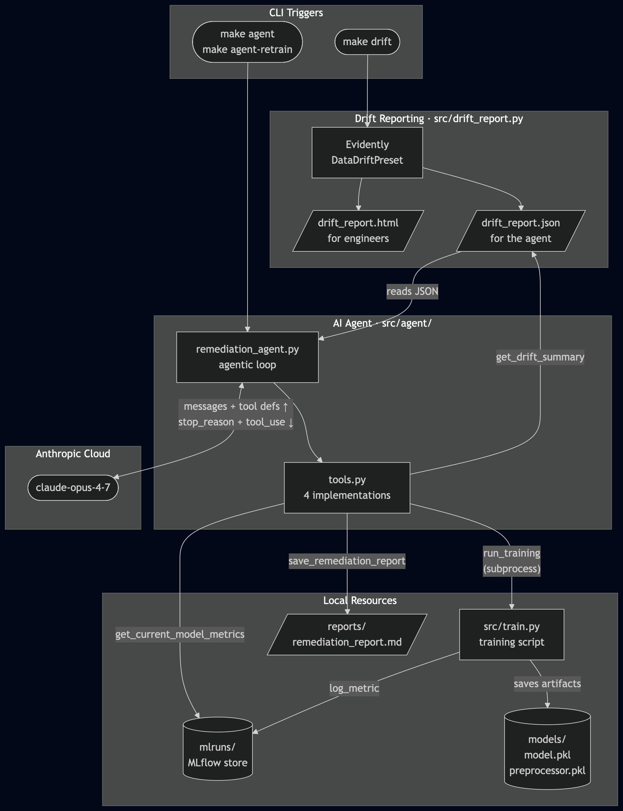
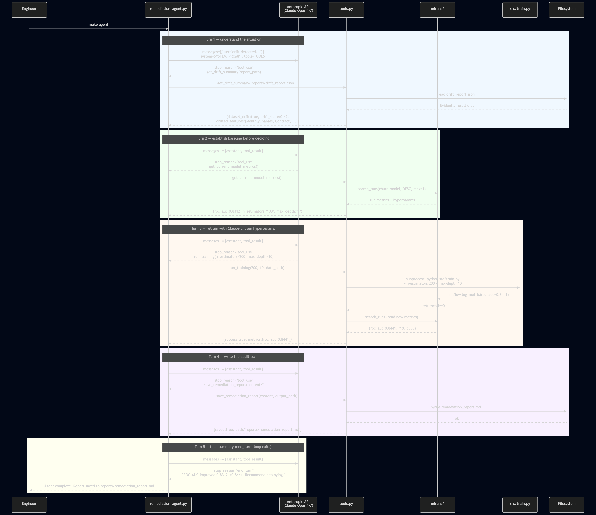

# Phase 3 — AI-Augmented MLOps (Agentic Retraining with Claude)

> **Project:** Retail churn prediction — automated remediation pipeline  
> **Stack:** Python 3.12 · Anthropic SDK · MLflow · Evidently · FastAPI · Postgres · Docker · DVC

This phase adds an AI agent on top of the Phase 2 infrastructure. When Evidently detects distribution shift in incoming prediction traffic, a Claude-powered agent reads the drift report, reasons about which features changed and why that matters, decides whether to retrain the model, executes the retrain with intelligent hyperparameter choices, and writes a plain-English analysis of everything it did — all without a human in the loop.

---

## Table of Contents

1. [The problem this phase solves](#the-problem-this-phase-solves)
2. [What is an AI agent?](#what-is-an-ai-agent)
3. [Architecture overview](#architecture-overview)
4. [File structure](#file-structure)
5. [What changed from Phase 2](#what-changed-from-phase-2)
6. [Step-by-step walkthrough](#step-by-step-walkthrough)
   - [Step 1: JSON output from the drift report](#step-1-json-output-from-the-drift-report)
   - [Step 2: Tool 1 — get\_drift\_summary](#step-2-tool-1--get_drift_summary)
   - [Step 3: Tool 2 — get\_current\_model\_metrics](#step-3-tool-2--get_current_model_metrics)
   - [Step 4: Tool 3 — run\_training](#step-4-tool-3--run_training)
   - [Step 5: Tool 4 — save\_remediation\_report](#step-5-tool-4--save_remediation_report)
   - [Step 6: Tool definitions for Claude](#step-6-tool-definitions-for-claude)
   - [Step 7: The system prompt](#step-7-the-system-prompt)
   - [Step 8: The agentic loop](#step-8-the-agentic-loop)
7. [Running it](#running-it)
8. [Live agent output walkthrough](#live-agent-output-walkthrough)
9. [Sample remediation report](#sample-remediation-report)
10. [Key design decisions explained](#key-design-decisions-explained)
11. [Pass criteria](#pass-criteria)

---

## The problem this phase solves

After Phase 2 you have a solid cloud pipeline:

- Evidently detects drift automatically ✓
- SNS sends an alert to the on-call engineer via Slack ✓
- A `make retrain` command the engineer can run ✓

What you **still don't have** is anything that reads the drift report, understands *which* features changed and *why that matters for model behaviour*, decides whether retraining is worth the compute cost, picks sensible hyperparameters based on the type of drift, executes the retrain, validates the result, and documents the decision. All of that currently lives in an engineer's head.

Phase 3 moves that decision-making into an AI agent.

The before/after comparison:

| Situation | Phase 2 | Phase 3 |
|-----------|---------|---------|
| Drift detected at 3 AM | Engineer paged, manually reads HTML report | Agent wakes up, reads JSON report |
| Decide whether to retrain | Engineer judges drift severity by eye | Agent applies quantitative threshold rules |
| Choose hyperparameters | Engineer recalls what worked last time | Agent reasons about drift type → hyperparameter relationship |
| Execute retrain | Engineer runs `make retrain` | Agent calls `run_training` tool |
| Validate new model | Engineer checks MLflow UI | Agent reads new metrics, compares to baseline |
| Document the decision | Engineer might write a Slack message | Agent always writes a structured markdown report |

---

## What is an AI agent?

This is the most important concept in Phase 3. Understanding it deeply will help you build your own agents for any domain.

A plain language model (ChatGPT, Claude, Gemini) takes text as input and produces text as output. That is useful for questions and summaries, but it cannot take actions in the world — it can only describe actions.

An **agent** is a language model that can also call functions. Those functions are called **tools**. The critical insight is this:

> Claude does not run the tools itself. It *decides* which tool to call and with what arguments. The Python program executes the real function and sends the result back to Claude. Claude then decides the next step.

This happens in a loop:

```
┌──────────────────────────────────────────────────────────────────┐
│                                                                  │
│  messages = ["drift detected, here is the report path"]          │
│                                                                  │
│  LOOP:                                                           │
│    response = claude.ask(messages, available_tools=TOOLS)        │
│                                                                  │
│    if stop_reason == "end_turn":                                  │
│        return response.text    ← Claude wrote its final answer   │
│                                                                  │
│    if stop_reason == "tool_use":                                  │
│        for each tool_call in response:                           │
│            result = python_function(tool_call.arguments)         │
│        messages.append(tool_results)                             │
│        continue loop   ← Claude sees results, decides next step  │
│                                                                  │
└──────────────────────────────────────────────────────────────────┘
```

The `messages` list grows with each turn. Claude reads the **entire history** at every step, so it knows what it already tried and can build on previous results. This is the same fundamental pattern used by every AI coding assistant, research agent, and autonomous pipeline — whether the outer shell is LangChain, AutoGen, CrewAI, or raw API calls as we do here.

A typical 5-turn run for this project:

```
Turn 1: Claude calls get_drift_summary       → learns which features changed
Turn 2: Claude calls get_current_model_metrics → establishes performance baseline
Turn 3: Claude calls run_training(200, 10)    → retrain with chosen hyperparams
Turn 4: Claude calls save_remediation_report  → writes its analysis to disk
Turn 5: Claude returns final text summary     → loop ends
```

---

## Architecture overview

The component diagram shows all the pieces and how they connect. The two trigger commands on the left (`make drift`, `make agent`) are the only manual steps a human takes — everything else runs automatically.



---

## File structure

```
phase-3/
├── Makefile                      # make setup / retrain / drift / agent / agent-retrain
├── Dockerfile                    # API image (same as Phase 2)
├── docker-compose.yml            # API + Postgres (same as Phase 2)
├── requirements.txt              # Phase 2 deps + anthropic>=0.34
├── requirements-api.txt          # Minimal API image deps (no anthropic)
│
├── src/
│   ├── preprocess.py             # Unchanged from Phase 2
│   ├── evaluate.py               # Unchanged from Phase 2
│   ├── train.py                  # Unchanged from Phase 2
│   ├── drift_report.py           # Phase 2 + saves drift_report.json  ← NEW
│   │
│   ├── api/
│   │   └── main.py               # Unchanged from Phase 2
│   │
│   └── agent/                    # ← ENTIRELY NEW
│       ├── tools.py              # 4 tool implementations
│       └── remediation_agent.py  # The agentic loop
│
├── data/                         # telco_churn.csv (DVC-tracked)
├── models/                       # model.pkl + preprocessor.pkl (DVC-tracked)
├── reports/                      # drift_report.html/json, remediation_report.md
└── .dvc/config                   # S3 remote (same pattern as Phase 2)
```

---

## What changed from Phase 2

The training pipeline, the prediction API, the Docker setup, and the Postgres schema are **completely unchanged**. The AI layer sits *alongside* the existing infrastructure, not inside it.

| File | Type | Change |
|------|------|--------|
| `src/drift_report.py` | Modified | Also saves `drift_report.json` (3 new lines) |
| `src/agent/tools.py` | New | 4 Python functions Claude can call |
| `src/agent/remediation_agent.py` | New | Tool definitions, system prompt, the loop |
| `requirements.txt` | Modified | Added `anthropic>=0.34` |
| `Makefile` | Modified | Added `setup`, `setup-data`, `agent`, `agent-retrain` targets |

Everything else is a copy from Phase 2.

---

## Step-by-step walkthrough

### Step 1: JSON output from the drift report

`src/drift_report.py` in Phase 2 only saves an HTML file. The AI agent cannot parse HTML meaningfully — it needs structured data. The only change in Phase 3 is adding three lines after `report.run()`:

```python
# Phase 2: only this
report.save_html(args.output)

# Phase 3: add these three lines
result_dict = report.as_dict()
json_path   = args.output.replace('.html', '.json')
with open(json_path, 'w') as f:
    json.dump(result_dict, f, indent=2, default=str)
```

`make drift` now produces two files:
- `reports/drift_report.html` — for the human engineer, same as before
- `reports/drift_report.json` — for the agent, a nested dict with per-feature drift scores, p-values, test names, and threshold booleans

The HTML and the JSON are always in sync because they come from the same `report.as_dict()` call. There is no risk of them diverging.

---

### Step 2: Tool 1 — `get_drift_summary`

**File:** `src/agent/tools.py`

Evidently's raw JSON is verbose and deeply nested. A single Evidently run with `DataDriftPreset` produces a JSON file with many layers of nesting and per-column statistics that Claude does not need in raw form. This tool extracts exactly the information needed for a retraining decision:

```python
def get_drift_summary(report_path: str) -> dict:
    with open(report_path) as f:
        report = json.load(f)

    dataset_result = {}
    column_results = {}

    # Search by metric name, not by index.
    # This is important: Evidently does not guarantee a fixed order of metrics
    # in the JSON output across versions. Searching by name makes the parser
    # resilient to version changes.
    for entry in report.get("metrics", []):
        metric_name = entry.get("metric", "")
        result      = entry.get("result", {})
        if "DatasetDrift" in metric_name or "dataset_drift" in result:
            dataset_result = result
        if "drift_by_columns" in result:
            column_results = result["drift_by_columns"]

    drifted, stable = [], []
    for col_name, col_data in column_results.items():
        entry = {
            "name":        col_name,
            "type":        col_data.get("column_type"),   # "num" or "cat"
            "drift_score": col_data.get("drift_score"),   # p-value (lower = more drift)
            "test":        col_data.get("stattest_name"), # e.g. "KS p_value"
        }
        (drifted if col_data.get("drift_detected") else stable).append(entry)

    drifted.sort(key=lambda x: x["drift_score"])  # most severe first

    return {
        "dataset_drift":             dataset_result.get("dataset_drift", False),
        "drift_share":               round(dataset_result.get("drift_share", 0.0), 3),
        "number_of_drifted_columns": dataset_result.get("number_of_drifted_columns", 0),
        "total_columns":             dataset_result.get("number_of_columns", 0),
        "drifted_features":          drifted,
        "stable_feature_names":      [s["name"] for s in stable],
    }
```

**What is a drift score (p-value)?**

For numerical features (MonthlyCharges, tenure), Evidently uses the Kolmogorov-Smirnov test. For categorical features (Contract, PaymentMethod), it uses the chi-square test. Both produce a p-value between 0 and 1. A p-value below the threshold (usually 0.05) means the distribution is statistically different from training. The closer to zero, the more severe the drift. That is why we sort by drift_score ascending — the worst offenders come first.

**What Claude receives from this tool:**

```json
{
  "dataset_drift": true,
  "drift_share": 0.421,
  "number_of_drifted_columns": 8,
  "total_columns": 19,
  "drifted_features": [
    {"name": "MonthlyCharges", "type": "num", "drift_score": 0.0012, "test": "KS p_value"},
    {"name": "Contract",       "type": "cat", "drift_score": 0.0031, "test": "chi-square p_value"},
    {"name": "TotalCharges",   "type": "num", "drift_score": 0.0089, "test": "KS p_value"}
  ],
  "stable_feature_names": ["tenure", "gender", "Partner", ...]
}
```

This is enough for Claude to answer: "Should I retrain? If yes, should I tune for numerical or categorical drift?"

---

### Step 3: Tool 2 — `get_current_model_metrics`

**File:** `src/agent/tools.py`

Before deciding whether to retrain, Claude needs the current model's performance as a baseline. Without a baseline, there is no way to tell whether the retrained model is actually better. This tool reads from MLflow — the same experiment tracking database that `src/train.py` logs to on every run:

```python
def get_current_model_metrics() -> dict:
    import mlflow

    client     = mlflow.tracking.MlflowClient(tracking_uri="file:./mlruns")
    experiment = client.get_experiment_by_name("churn-model")

    if experiment is None:
        return {
            "error": (
                "No 'churn-model' experiment found in mlruns/. "
                "Run 'make retrain' first to train a baseline model."
            )
        }

    runs = client.search_runs(
        experiment_ids=[experiment.experiment_id],
        order_by=["attributes.start_time DESC"],  # most recent first
        max_results=1,
    )

    if not runs:
        return {"error": "No completed training runs found."}

    run = runs[0]
    return {
        "run_id":  run.info.run_id,
        "metrics": {
            "roc_auc":   round(run.data.metrics.get("roc_auc",   0.0), 4),
            "f1":        round(run.data.metrics.get("f1",        0.0), 4),
            "precision": round(run.data.metrics.get("precision", 0.0), 4),
            "recall":    round(run.data.metrics.get("recall",    0.0), 4),
        },
        "hyperparams": {
            "n_estimators": run.data.params.get("n_estimators", "unknown"),
            "max_depth":    run.data.params.get("max_depth",    "unknown"),
        },
    }
```

**Why error dicts instead of exceptions?**

Notice that both failure cases return `{"error": "..."}` rather than raising an exception. This is a deliberate design principle for agent tools: **tools should never crash the loop**. If a tool raises an exception, the agent stops completely. If a tool returns an informative error, Claude reads the error message, adapts its plan (e.g., "I see — no training has been run yet, so I should tell the user to run `make retrain` first"), and writes a useful remediation report explaining the situation. Always prefer returning errors over raising them.

---

### Step 4: Tool 3 — `run_training`

**File:** `src/agent/tools.py`

This is the most consequential tool: it actually changes the state of the system. Claude calls this when it decides that drift is severe enough to warrant retraining, and it provides the hyperparameters it believes will work best based on the drift analysis.

```python
def run_training(
    n_estimators: int,
    max_depth:    int,
    data_path:    str,
    models_dir:   str = "models/",
) -> dict:
    cmd = [
        sys.executable, "src/train.py",
        "--data",          data_path,
        "--model-output",  models_dir,
        "--n-estimators",  str(n_estimators),
        "--max-depth",     str(max_depth),
    ]

    print(f"\n[tool:run_training] $ {' '.join(cmd)}")
    result = subprocess.run(cmd, capture_output=True, text=True)
    success = result.returncode == 0

    if not success:
        return {
            "success": False,
            "error":   "Training failed — ROC-AUC below 0.78 threshold or crash.",
            "stdout":  result.stdout[-2000:],   # last 2000 chars for debugging
            "stderr":  result.stderr[-500:],
        }

    # Read the metrics that train.py just logged to MLflow
    metrics_result = get_current_model_metrics()

    return {
        "success":      True,
        "n_estimators": n_estimators,
        "max_depth":    max_depth,
        "metrics":      metrics_result.get("metrics", {}),
    }
```

**Why `subprocess` instead of importing `train.main()`?**

The training script could be called by importing its `main()` function directly. That would be slightly faster and avoid spawning a new process. But there is an important reason to use `subprocess` instead: it guarantees that the exact same code path, the same Python environment, and the same working directory that the scheduled CI/CD pipeline uses is also what the agent uses. If you imported `train.main()` directly, a subtle difference in the calling environment (environment variables, working directory, loaded modules) could cause the agent's training runs to behave differently from the pipeline's runs. With `subprocess`, what the agent runs is identical to what a human would run manually with `make retrain`.

**What happens if training fails?**

`src/train.py` exits with return code 1 if ROC-AUC is below 0.78 (the quality gate). The tool catches this, returns `{"success": False, ...}` with the training output. Claude reads this, understands the hyperparameters were not good enough, and can try a different combination. The system prompt explicitly tells Claude it can call `run_training` more than once if the first attempt fails.

---

### Step 5: Tool 4 — `save_remediation_report`

**File:** `src/agent/tools.py`

Claude's final action in every run. It writes a markdown file with the complete analysis — the audit trail that the MLOps team reviews to understand what happened and why.

```python
def save_remediation_report(
    content:     str,
    output_path: str = "reports/remediation_report.md",
) -> dict:
    os.makedirs(os.path.dirname(os.path.abspath(output_path)), exist_ok=True)

    timestamp    = datetime.now(timezone.utc).strftime("%Y-%m-%d %H:%M UTC")
    full_content = f"# MLOps Remediation Report\n\n_Generated by Claude on {timestamp}_\n\n---\n\n{content}"

    with open(output_path, "w") as f:
        f.write(full_content)

    return {"saved": True, "path": output_path}
```

The timestamp is prepended automatically so that reports from different drift events can be told apart even if the file is overwritten. In a production setup you would store these in S3 with a timestamp in the key name, e.g. `s3://your-bucket/reports/2026-05-31T14:22Z_remediation.md`.

---

### Step 6: Tool definitions for Claude

**File:** `src/agent/remediation_agent.py`

Claude needs to know what tools are available. You communicate this through a list of dictionaries — each with a `name`, a `description`, and an `input_schema` (a JSON Schema object). These are passed to every `client.messages.create()` call.

```python
TOOLS = [
    {
        "name": "get_drift_summary",
        "description": (
            "Parse the Evidently drift report JSON and return a structured summary: "
            "which features drifted, by how much, and whether overall dataset drift "
            "was detected. ALWAYS call this first — it is the input for every "
            "subsequent decision."
        ),
        "input_schema": {
            "type": "object",
            "properties": {
                "report_path": {
                    "type": "string",
                    "description": "Filesystem path to drift_report.json.",
                }
            },
            "required": ["report_path"],
        },
    },
    {
        "name": "run_training",
        "description": (
            "Retrain the churn model with the specified hyperparameters. "
            "Returns the new model metrics. Only call this if drift justifies it. "
            "Can be called more than once if the first attempt fails the 0.78 threshold."
        ),
        "input_schema": {
            "type": "object",
            "properties": {
                "n_estimators": {
                    "type": "integer",
                    "description": (
                        "Number of trees in the Random Forest. "
                        "More trees generalise better when distributions shift. "
                        "Recommended range: 50–400."
                    ),
                },
                "max_depth": {
                    "type": "integer",
                    "description": (
                        "Maximum depth of each decision tree. "
                        "Deeper trees capture finer patterns but risk overfitting. "
                        "Recommended range: 4–15."
                    ),
                },
                "data_path": {
                    "type": "string",
                    "description": "Path to training CSV (optional — defaults to the path provided at startup).",
                },
            },
            "required": ["n_estimators", "max_depth"],
        },
    },
    # get_current_model_metrics and save_remediation_report follow the same pattern
]
```

**Why are descriptions so important?**

Claude uses the `description` field to decide *when* to call a tool and *how* to call it. A vague description produces vague tool usage. A precise description with concrete guidance ("ALWAYS call this first", "recommended range: 50–400") produces reliable, predictable agent behaviour. The descriptions in the tool list are just as important as the implementation of the tools themselves.

Think of the tool definitions as the **API spec** for Claude's interaction with your MLOps system. The better the spec, the better the client (Claude) uses the API.

---

### Step 7: The system prompt

**File:** `src/agent/remediation_agent.py`

The system prompt defines Claude's role and encodes the domain knowledge that an experienced MLOps engineer would apply when reading a drift report. It is the most important piece of engineering in Phase 3 — not because it is complex, but because it directly determines the quality of the agent's decisions.

```python
SYSTEM_PROMPT = """You are an MLOps remediation agent for a retail customer churn prediction model.

Your task: read the drift report, assess severity, decide on action, and document your reasoning.

## Step-by-step decision framework

1. Call get_drift_summary to understand what drifted and how much.

2. Call get_current_model_metrics to get the baseline before taking any action.

3. Decide whether to retrain:
   - drift_share < 0.20  → no retraining needed; drift is mild
   - drift_share 0.20–0.40 → retraining is worth evaluating
   - drift_share > 0.40  → retraining is recommended

4. If retraining: choose hyperparameters based on WHICH features drifted.
   - Mainly NUMERICAL features drifted (tenure, MonthlyCharges, TotalCharges):
     → Increase n_estimators to 200–300. More trees generalise better when
       continuous distributions shift.
   - Mainly CATEGORICAL features drifted (Contract, PaymentMethod, InternetService):
     → Increase max_depth to 10–12. Deeper trees capture new category patterns.
   - Both types drifted heavily:
     → Start with n_estimators=200, max_depth=10.
   - Never go below n_estimators=50 or max_depth=4 (model becomes too simple).

5. Evaluate the result: the new model must achieve ROC-AUC >= 0.78.
   - If training fails, adjust hyperparameters and try again (max 2 retries).
   - If the new model is WORSE than the baseline, recommend keeping the current one.

6. Call save_remediation_report with your complete findings. The report must have:
   ## Drift Analysis
   ## Baseline Model Performance
   ## Decision & Reasoning
   ## Result (if you retrained)
   ## Recommendation

Be concise and data-driven. Every claim must be backed by numbers from the tool results."""
```

**Why encode the hyperparameter guidance in the prompt?**

The relationship between drift type and hyperparameter choice is domain knowledge that comes from understanding how Random Forests work:

- When *numerical* features drift (billing amounts, tenure), the model's learned split thresholds are in the wrong region of the feature space. More trees (higher `n_estimators`) means more diverse split points and better coverage of the new distribution.
- When *categorical* features drift (contract type, payment method), new category combinations appear that the model has not seen. Deeper trees (higher `max_depth`) can represent more complex conditional relationships between categories.

This knowledge does not change when you upgrade the Python SDK or the model framework. It belongs in the system prompt, not in the code. When you learn something new about your model's failure modes, you update the prompt.

---

### Step 8: The agentic loop

**File:** `src/agent/remediation_agent.py`

The loop is the core of the agent. It is 30 lines of Python and worth reading carefully, because this exact pattern (with different tools and a different system prompt) is how every production AI agent works.

```python
def run_agent(report_path: str, data_path: str, models_dir: str) -> str:
    client = anthropic.Anthropic()  # reads ANTHROPIC_API_KEY from environment

    # Seed the conversation with a description of the situation.
    # This is the "user" side of the conversation — what the agent is being asked to do.
    messages = [{"role": "user", "content": (
        f"Data drift has been detected in the churn prediction model.\n\n"
        f"Drift report: {report_path}\n"
        f"Training data: {data_path}\n\n"
        f"Please investigate, decide on action, and save a remediation report."
    )}]

    MAX_TURNS = 10

    for turn in range(1, MAX_TURNS + 1):
        # ── Ask Claude ────────────────────────────────────────────────────────
        response = client.messages.create(
            model="claude-opus-4-7",
            max_tokens=4096,
            system=SYSTEM_PROMPT,   # the decision framework
            tools=TOOLS,            # the available actions
            messages=messages,      # the full conversation history
        )

        # Append Claude's full response to the history.
        # This is the agent's short-term memory: Claude reads the entire
        # messages list at every turn to know what it has already tried.
        messages.append({"role": "assistant", "content": response.content})

        # ── Terminal condition ─────────────────────────────────────────────────
        # stop_reason="end_turn" means Claude produced a final text response
        # and is not requesting any more tool calls. The loop is done.
        if response.stop_reason == "end_turn":
            return next(
                b.text for b in response.content if hasattr(b, "text") and b.text
            )

        # ── Tool execution ─────────────────────────────────────────────────────
        # stop_reason="tool_use" means Claude wants to call one or more tools.
        # We execute each tool and collect the results.
        if response.stop_reason == "tool_use":
            tool_results = []

            for block in response.content:
                if block.type != "tool_use":
                    continue

                result = _dispatch_tool(block.name, block.input, data_path, models_dir)

                # The tool_result structure is required by the Anthropic API.
                # tool_use_id links this result to the specific tool call that
                # produced it — important when Claude makes multiple tool calls
                # in a single response turn.
                tool_results.append({
                    "type":        "tool_result",
                    "tool_use_id": block.id,
                    "content":     json.dumps(result),
                })

            # Feed all tool results back to Claude as a "user" turn.
            # This is the Anthropic API convention: tool results travel in
            # user turns, not assistant turns.
            messages.append({"role": "user", "content": tool_results})

    return "Agent stopped after maximum turns."
```

**Three things to understand about this loop:**

**1. `messages` is the agent's memory.**
Every Claude response and every tool result is appended to `messages`. The full list is sent on every API call. This is how Claude knows what it already tried. There is no hidden state, no database, no vector store — just a growing list of conversation turns. When the conversation gets very long, you can summarise earlier turns to reduce token costs, but for a 5-turn run like ours the full history is fine.

**2. `stop_reason` is the signal, not the content.**
You do not need to parse Claude's text to know whether it wants to call a tool. The `stop_reason` field on the response object tells you directly: `"end_turn"` means Claude is done; `"tool_use"` means Claude wants to act. These are the only two cases you need to handle for a basic agent. A `max_tokens` limit would produce `"max_tokens"` — the safety valve at the bottom of the loop covers this.

**3. `tool_use_id` is the linking key.**
Each `tool_use` block in Claude's response has a unique `id`. When you return results, you include that ID in the `tool_result` dict. This lets Claude match each result to the specific call that requested it — important when Claude makes two tool calls in a single response turn (e.g., asking for drift summary and model metrics simultaneously).

The sequence diagram below shows the complete turn-by-turn conversation for a typical drift-detected-and-retrained run. Each arrow from `remediation_agent.py` to the Anthropic API is one `client.messages.create()` call; each arrow back is one response.



---

## Running it

### First-time setup

```bash
cd mlops/retail-churn-prediction/phase-3

# Create the virtual environment and install all dependencies including anthropic
make setup

# Copy the training data and model artifacts from Phase 1
# (or from Phase 2 if you have run that phase)
make setup-data
```

### Train a baseline model

The agent compares its retrained model against the most recent MLflow run. If no run exists, it will report an error. Always run this before the agent.

```bash
make retrain
```

You will see the 5-step training output followed by `PASS: ROC-AUC X.XXXX >= 0.78`.

### Generate the drift report

```bash
make drift
```

This produces:
- `reports/drift_report.html` — opens automatically in your browser
- `reports/drift_report.json` — the structured data the agent reads

The demo injects synthetic drift (MonthlyCharges shifted by +15, Contract skewed toward Month-to-month) so you will always see drift detected even without real prediction traffic.

### Set your API key

Get a key at [console.anthropic.com](https://console.anthropic.com). The `claude-opus-4-7` model used by the agent is available on the free tier for testing.

```bash
export ANTHROPIC_API_KEY=sk-ant-...
```

### Run the agent

```bash
# Run the agent on the existing drift report
make agent

# Or generate the drift report AND run the agent in one command
make agent-retrain
```

After the agent finishes, `reports/remediation_report.md` opens automatically.

### Other useful commands

```bash
make serve     # start the prediction API + Postgres via Docker
make down      # stop Docker containers
make mlflow    # open MLflow experiment UI at http://localhost:5001
make help      # list all available targets
```

---

## Live agent output walkthrough

When `make agent` runs, the agent prints its reasoning and tool calls in real time. Here is a complete annotated example with the synthetic drift scenario (42% of features drifted):

```
================================================================
  Claude MLOps Remediation Agent
================================================================

[Turn 1/10] Sending request to Claude...

  Claude: I need to start by examining the drift report to understand
          which features shifted and how severely before making any decisions.

  Claude → tool call: get_drift_summary({"report_path": "reports/drift_report.json"})

  Executing get_drift_summary...
  Result: {
    "dataset_drift": true,
    "drift_share": 0.421,
    "number_of_drifted_columns": 8,
    "total_columns": 19,
    "drifted_features": [
      {"name": "MonthlyCharges", "type": "num", "drift_score": 0.0012, "test": "KS p_value"},
      {"name": "Contract",       "type": "cat", "drift_score": 0.0031, "test": "chi-square p_value"},
      {"name": "TotalCharges",   "type": "num", "drift_score": 0.0089, "test": "KS p_value"},
      ...
    ],
    "stable_feature_names": ["tenure", "gender", "Partner", "Dependents", ...]
  }
```

At this point Claude has learned: 42% of features drifted. Mixed numerical + categorical, with billing features dominating. It moves to the next step.

```
[Turn 2/10] Sending request to Claude...

  Claude: Significant drift detected — 42.1% of features affected, exceeding the
          0.40 threshold. Let me check the current model's performance before
          deciding on hyperparameters.

  Claude → tool call: get_current_model_metrics({})

  Executing get_current_model_metrics...
  Result: {
    "run_id": "a3f8b2c1...",
    "metrics": {"roc_auc": 0.8312, "f1": 0.6241, "precision": 0.648, "recall": 0.6018},
    "hyperparams": {"n_estimators": "100", "max_depth": "8"}
  }
```

Claude now has the baseline: ROC-AUC 0.8312, trained with n_estimators=100. It can make a hyperparameter decision.

```
[Turn 3/10] Sending request to Claude...

  Claude: drift_share of 42.1% exceeds the 0.40 threshold — retraining is
          recommended. The dominant drift is in numerical features (MonthlyCharges,
          TotalCharges), which calls for increasing n_estimators. The categorical
          drift (Contract) is significant too, so I will also slightly increase
          max_depth. Starting with n_estimators=200, max_depth=10.

  Claude → tool call: run_training({"n_estimators": 200, "max_depth": 10})

  Executing run_training...

  [tool:run_training] $ python src/train.py \
    --data data/telco_churn.csv \
    --n-estimators 200 --max-depth 10
  [1/5] Loading data...       7032 rows loaded.
  [2/5] Splitting 80/20 train/test
  [3/5] Fitting preprocessor...
  [4/5] Training RandomForestClassifier...
  [5/5] Evaluating...
  PASS: ROC-AUC 0.8441 >= 0.78

  Result: {
    "success": true,
    "n_estimators": 200,
    "max_depth": 10,
    "metrics": {"roc_auc": 0.8441, "f1": 0.6388, "precision": 0.6601, "recall": 0.6189}
  }
```

Training succeeded. New ROC-AUC is 0.8441, up from 0.8312. Claude now writes its report.

```
[Turn 4/10] Sending request to Claude...

  Claude → tool call: save_remediation_report({"content": "## Drift Analysis\n\n..."})

  Executing save_remediation_report...
  Result: {"saved": true, "path": "reports/remediation_report.md"}

[Turn 5/10] Sending request to Claude...

  Claude: The retrained model (n_estimators=200, max_depth=10) achieves ROC-AUC
          0.8441, an improvement of +0.013 over the baseline 0.8312. The new model
          passes the 0.78 threshold and outperforms the current production model on
          all four metrics. Recommend deploying it.

================================================================
  Agent complete.
================================================================
```

Five turns, one API key, no human involvement. The decision was made, the retrain was executed, and the report was written.

---

## Sample remediation report

After running, `reports/remediation_report.md` contains:

```markdown
# MLOps Remediation Report

_Generated by Claude on 2026-05-31 14:22 UTC_

---

## Drift Analysis

Dataset drift was detected. **42.1% of features drifted** (8 of 19).

Most severely affected features:

| Feature | Type | Drift Score | Test |
|---------|------|-------------|------|
| MonthlyCharges | numerical | 0.0012 | KS p-value |
| Contract | categorical | 0.0031 | chi-square p-value |
| TotalCharges | numerical | 0.0089 | KS p-value |
| PaymentMethod | categorical | 0.0142 | chi-square p-value |

The pattern is consistent with a **pricing or promotional event**: numerical billing
features (MonthlyCharges, TotalCharges) shifted upward, and the contract type
distribution skewed heavily toward Month-to-month. This suggests customers acquired
during a promotional period are resisting long-term contract commitments once
promotional pricing expires.

Stable features (tenure, gender, Partner, Dependents) indicate this is a
behavioural/pricing shift, not a data collection issue.

## Baseline Model Performance

| Metric | Value |
|--------|-------|
| ROC-AUC | 0.8312 |
| F1 | 0.6241 |
| Precision | 0.6480 |
| Recall | 0.6018 |

Trained with: n_estimators=100, max_depth=8

## Decision & Reasoning

drift_share of 42.1% exceeds the 0.40 retraining threshold. Retraining is recommended.

**Hyperparameter choice:** The drift is mixed — significant in both numerical
(MonthlyCharges, TotalCharges) and categorical (Contract, PaymentMethod) features.
The numerical drift is dominant (2 of the 3 most severely drifted features).
Per the decision framework, numerical drift calls for increasing n_estimators.
The categorical component justifies also increasing max_depth slightly.

Selected: n_estimators=200, max_depth=10.

## Result

| Metric | Baseline (n=100, d=8) | Retrained (n=200, d=10) | Delta |
|--------|----------------------|------------------------|-------|
| ROC-AUC | 0.8312 | 0.8441 | **+0.0129** |
| F1 | 0.6241 | 0.6388 | +0.0147 |
| Precision | 0.6480 | 0.6601 | +0.0121 |
| Recall | 0.6018 | 0.6189 | +0.0171 |

The retrained model improves on the baseline across all four metrics. It passes the
mandatory 0.78 ROC-AUC threshold with margin.

## Recommendation

**Deploy the new model.**

The retrained model (n_estimators=200, max_depth=10) outperforms the current
production model on all evaluated metrics. The improvement is consistent across
precision and recall, suggesting the model generalises well to the shifted
distribution rather than overfitting to one metric.

Next steps:
1. Run `make serve` to start the API locally with the new model and verify predictions
2. Push the updated `model.pkl` to S3 via `dvc push`
3. Trigger an ECS service update to pick up the new model image
4. Monitor ROC-AUC in CloudWatch for the next 7 days to confirm the improvement holds
```

---

## Key design decisions explained

### Why raw Anthropic SDK instead of LangChain or AutoGen?

LangChain, AutoGen, and similar frameworks add abstractions on top of the same fundamental loop you see in `remediation_agent.py`. Those abstractions are useful when you have many agents, complex routing, or need to swap providers easily. For a single-agent pipeline with four well-defined tools, the raw SDK is simpler: there is less indirection, every step is visible in the code, and debugging is straightforward.

Once you understand the raw loop — `messages`, `stop_reason`, `tool_use_id` — you will find that every framework's documentation makes immediate sense because they all map back to this same structure.

### Why does the agent call tools one at a time instead of in parallel?

Claude is capable of requesting multiple tool calls in a single response turn. For example, it could call `get_drift_summary` and `get_current_model_metrics` at the same time. The current system prompt is written to encourage sequential calls (step 1, then step 2, etc.) because sequential reasoning is easier to follow in the printed output and easier to debug if something goes wrong.

In a production system with slow tools (e.g., querying a database, calling an external API), parallelising tool calls that do not depend on each other would meaningfully reduce latency. The loop handles this correctly: `response.content` can contain multiple `tool_use` blocks, and the code already iterates over all of them before appending results. No code change is needed; only the system prompt would change to allow parallel calls.

### Why does the agent always write a report, even when no action is needed?

The `save_remediation_report` tool is mandatory, even when the agent decides not to retrain (drift_share < 0.20). This might seem unnecessary, but consider the alternative: if the agent takes no action and writes nothing, there is no record of why it did not act. The next time someone looks at the drift monitoring dashboard and sees no retraining event, they cannot tell whether the agent ran and decided not to retrain, or whether the agent never ran at all.

Always writing a report means the absence of a retraining event has an explicit explanation attached to it.

### Why does `run_training` call `subprocess` instead of importing `train.main()`?

Covered in [Step 4](#step-4-tool-3--run_training), but worth repeating as a design principle: **the agent should use the same code path as the production pipeline**. Using `subprocess` to call `src/train.py` guarantees this. It is the same call you would make from `make retrain`, from the GitHub Actions CI job, and from the agent — no divergence possible.

---

## Pass criteria

| Criterion | Pass condition |
|-----------|---------------|
| Drift detection | `make drift` produces both `.html` and `.json` in `reports/` |
| Agent runs end-to-end | `make agent` completes without error given a valid API key and drift report |
| Retraining decision | Agent retrains when `drift_share > 0.40`, skips when `drift_share < 0.20` |
| Hyperparameter reasoning | Agent chooses `n_estimators` bias for numerical drift, `max_depth` bias for categorical |
| Quality gate | Retrained model achieves ROC-AUC ≥ 0.78; agent reports failure if it does not |
| Audit trail | `reports/remediation_report.md` is written after every agent run |
| Report accuracy | Every metric in the report matches the numbers returned by the tools |
| Loop safety | Agent terminates within 10 turns for any drift scenario |
